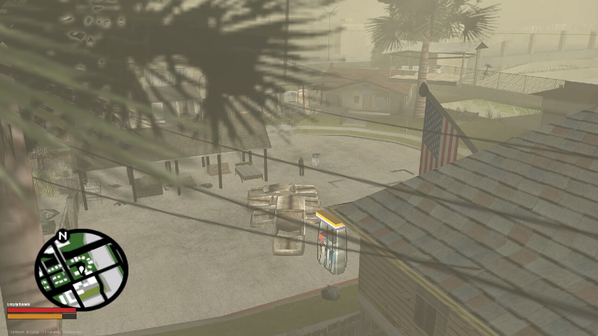
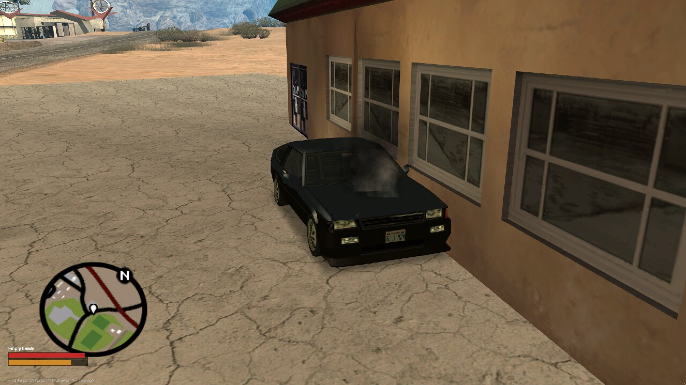
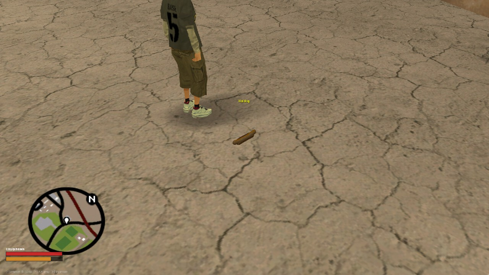
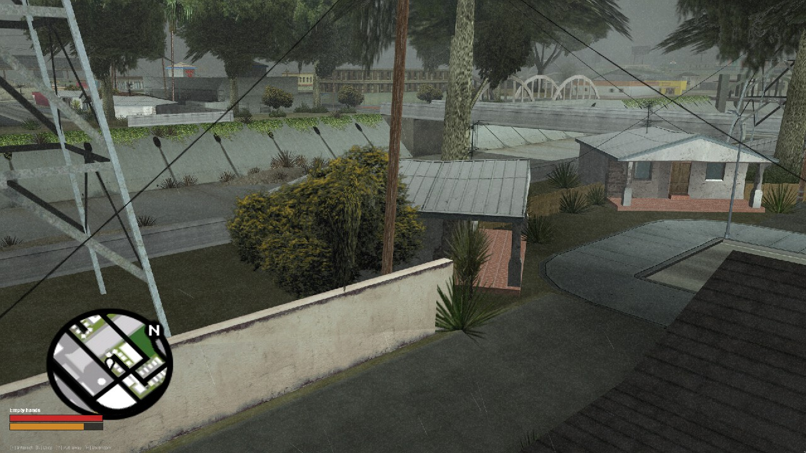

# Scavenge & Survive for MTA:SA

**PvP survival on a decayed San Andreas.** [Scavenge & Survive](https://github.com/Southclaws/ScavengeSurvive), the
SA-MP gamemode by Southclaws, rebuilt for MTA:SA 1.6 in Lua on MariaDB: one alive character, everything is a
physical item on the ground, wounds bleed, and death drops it all.




## What works today

| Milestone | Status | What you get |
| --- | :---: | --- |
| M0 Bootstrap & Data | ✅ | 302 item types, 15 loot tables, 11,062 loot points, 10 languages, 66 vehicle types and 2,017 vehicle points converted from upstream; migrations, procedures and seeds applied by one script |
| M1 Auth & Character | ✅ | Register/login, permadeath, hunger and bleeding ticks, death drops, anti-combat-log, SA-MP HUD (watch, hunger bar, key actions, brightness overlay, death screen) |
| M2 Items & Inventory | ✅ | Hands, 6-slot inventory, bags worn on the back, containers, food, SA-MP list dialogs; held items and bags on real bones with the SA-MP models |
| M3 Loot & World | ✅ | Loot rolling near players, all 221 upstream maps built client-side (23,211 objects), 7 server zone colshapes (`getZoneAt`, `onPlayerZoneEnter/Leave`), weather and a real-time clock (wild trees deferred) |
| M4 Weapons & Damage | 🟡 | Server-authoritative wound model with calibre and distance falloff. Left: ammo and magazines, knockouts, tracers, parity checklist |
| M5 Vehicles | 🟡 | Loot vehicles rolled over the upstream points, battered and near-empty, persisted across restarts. Left: fuel use, locks, trunks, trailers |
| M6 Crafting, Building, Apparel | ⬜ | |
| M7 Staff & Ops | ⬜ | Dev tooling exists (HTTP rcon, dev commands); staff tiers do not |
| M8 Content & Polish | ⬜ | Supply drops, caches, house loot, radio, ziplines |

Progress is tracked in the [issues](https://github.com/VIRUXE/scavengesurvive-mta/issues) and the
[project board](https://github.com/users/VIRUXE/projects/3); each milestone is an epic there.

|  |  |
| :---: | :---: |
| Loot vehicles spawn smoking, half-wrecked and almost out of fuel | Every item is an object on the ground, SA-MP models included |
|  | |
| Upstream's hollow houses replace the sealed vanilla models | |

## How it is built

- **One MTA resource per domain**, no prefix: `lib`, `data`, `models`, `maps`, `ui`, `auth`, `character`, `items`,
  `loot`, `vehicles`, `world`, `weapons`, `hud`, `dev`. They share state only through MariaDB, so any resource can
  restart alone and rebuild from the database.
- **MariaDB does the heavy lifting.** Every item-graph move (pickup, drop, container put/take, death drop) is a
  stored procedure that returns `ok, code, payload`; positions are `POINT` columns with spatial indexes.
- **Static world on the client.** The 221 upstream map files become `createBuilding` calls spread over frames
  (about 1.3 s on join), with the 209 SA-MP-only object models shipped in the `models` resource.
- **Damage is server-authoritative.** The victim's client reports a hit; the server checks the shooter's held weapon,
  range and rate, computes the wound and applies it.
- **Pure logic is testable.** Formulas live in `shared/logic/*.lua` with no MTA calls, so busted runs them on plain
  Lua 5.1; converters and SQL procedures have pytest coverage, the SQL tests against a live MariaDB.

Design: `docs/superpowers/specs/` (Appendix A is upstream behaviour, Appendix B the verified MTA facts).
Decisions: `docs/adr/`. Conventions every contributor and agent follows: `CLAUDE.md`.

## Quick start (Windows)

1. `pwsh tools/setup-dev.ps1` — Lua 5.1 toolchain, stylua, Python deps.
2. MariaDB 13.0 as a local service (root, no password) and MTA:SA 1.6 client + server installed.
3. `pwsh server-config/run-local.ps1` — creates the database, migrates, seeds, links the resources into the server
   and starts it. Connect to `127.0.0.1:22003`.
4. Drive the running server without touching the console: `pwsh server-config/rcon.ps1 help` (players, resource
   restarts, chat commands and bound keys as any player, Lua, screenshots). Details in `server-config/README.md`.

Before committing, the four local checks must pass (there is no CI; commits land on `main`):

```
.lua\bin\busted.bat tests/lua
.lua\bin\luacheck.bat resources
stylua --check resources
pytest -q
```

## Documentation map

| Where | What |
| --- | --- |
| `CLAUDE.md` | Conventions and rules (events, DB, state, style) |
| `docs/superpowers/specs/` | The port design, upstream digest and MTA facts |
| `docs/superpowers/plans/2026-09-27-mvp.md` | The MVP plan as executed |
| `docs/adr/` | Architecture decisions (0001: scarcity-driven respawn, proposed) |
| `docs/reviews/` | Review and live-check records with what was found and fixed |
| `docs/mvp-smoke-checklist.md` | The playtest checklist, extended as features land |
| `docs/maps-census.md` | Generated: every upstream map object classified vanilla / SA-MP-only |
| `docs/ui-reference-samp.md` | Every SA-MP UI element with upstream geometry, footage evidence and its MTA recipe; gap list vs the current resources |
| `server-config/README.md` | Local server setup, HTTP rcon, dev commands |
| `THIRD_PARTY_NOTICES.md` | Upstream data (MPL-2.0), maps (CC BY-SA 4.0), SA-MP models |

## Toolchain notes

`setup-dev.ps1` builds Lua 5.1.5 with hererocks' default target, which picks MSVC (`--target vs`) when Visual Studio
C++ Build Tools are installed (verified with Visual Studio Community 2026). Without MSVC, install a MinGW toolchain
(`winget install -e --id BrechtSanders.WinLibs.POSIX.UCRT`), put its `mingw64\bin` on `PATH`, and run
`python -m hererocks .lua -l 5.1.5 -r latest --target mingw` before `setup-dev.ps1` (the script then switches
LuaRocks from hererocks' `MSVCR80` link default to `ucrt`; a native rock that still imports `MSVCR80.dll` fails to
load with "The specified module could not be found" — rebuild it with `.lua/bin/luarocks.bat build <rock> --force`).
MariaDB installs as a Windows service from winget: `winget install -e --id MariaDB.Server --override "/qn
SERVICENAME=MariaDB ADDLOCAL=ALL PORT=3306"` (root with no password, which is the project default). The MSI does not add
its `bin` to `PATH`; add it, since `run-local.ps1` and the smoke checklist call `mariadb` by name.

## Credits and licences

Scavenge & Survive is Copyright (C) Barnaby "Southclaws" Keene and the community that built its maps from 2008 to
2017. New code here is released under the Unlicense; converted upstream data stays MPL-2.0 and the map placements
CC BY-SA 4.0; the SA-MP object models belong to the SA-MP team. See `THIRD_PARTY_NOTICES.md`.
