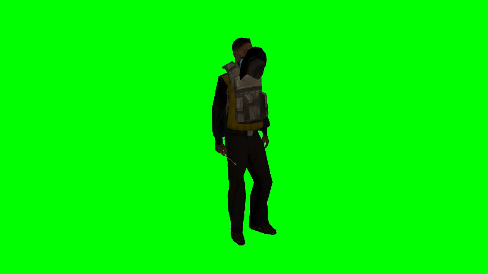
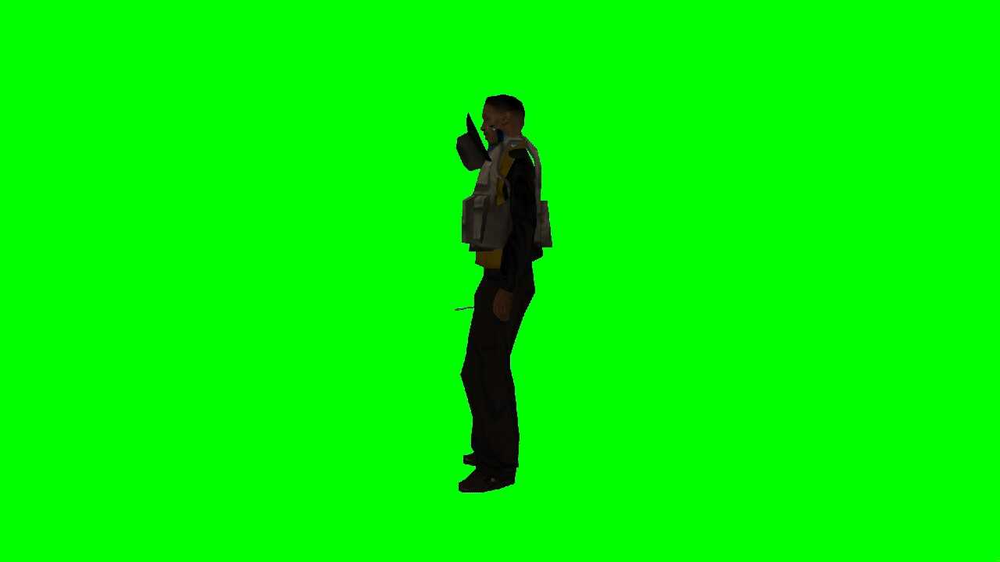

# Green-screen studio (`dev` resource)

A photo set for looking at a ped on its own. `/studio` moves the player into a private dimension high above the
map. They stand frozen inside a closed box of pure chroma green (`#00FF00`), with the camera placed on a fixed orbit.
Screenshots then show only the ped and what it wears or holds: skin, held items, apparel and attachments. No
scenery, sky, other players or HUD gets in the way, and lighting is the same from shot to shot.

| `threequarter` | `left` |
| :---: | :---: |
|  |  |

## Use

In game (dev commands, so `*dev.open` or an admin level is required):

| Command | Effect |
| :--- | :--- |
| `/studio [cam]` | Enter the studio. With no argument while inside, leave it. |
| `/studiocam <cam>` | Move the camera. |
| `/studiopose <rz>` | Turn the ped to heading `rz` (0 = facing north, toward the `front` camera). |

`cam` is either a preset or `yaw dist height [lookZ]`:

| Preset | yaw | dist | height | lookZ |
| :--- | ---: | ---: | ---: | ---: |
| `front` | 0 | 3.5 | 0.3 | 0 |
| `back` | 180 | 3.5 | 0.3 | 0 |
| `left` | 270 | 3.5 | 0.3 | 0 |
| `right` | 90 | 3.5 | 0.3 | 0 |
| `threequarter` (default) | 35 | 3.2 | 0.6 | 0 |
| `top` | 0 | 1.2 | 3.5 | 0 |
| `face` | 0 | 1.0 | 0.65 | 0.65 |
| `hands` | 30 | 1.4 | 0.1 | -0.1 |

- `yaw` is in degrees around the ped. 0 puts the camera in front of a ped facing north, and 90 puts it on the
  ped's right.
- `dist` is the horizontal distance.
- `height` and `lookZ` are the camera height and the look-at point, both measured from the ped's origin (about 1 m
  above its feet).
- Values are clamped so the camera stays inside the box.

From a script, or an agent driving the local server:

```powershell
pwsh server-config/rcon.ps1 studio VIRUXE threequarter   # enters if needed, then sets the camera
pwsh server-config/rcon.ps1 screenshot VIRUXE            # -> resources/[scavengesurvive]/dev/screenshots/VIRUXE-<time>.jpg
pwsh server-config/rcon.ps1 studio VIRUXE off            # back to where they were
```

## How it works

- **Set.** The client draws the box every frame with `dxDrawPrimitive3D("trianglelist", "postfx", …)`, so there are
  no model files. The `postfx` stage runs after colour correction, so the green reaches the screen unchanged. The
  draw is depth-tested, so the ped occludes the walls.
- **Floor.** Model 8661 (`gnhtelgrnd_lvs`, a flat slab) sits at `alpha 0` under the ped in the studio dimension, so
  the ped stands rather than playing a fall animation.
- **Isolation.** Each occupant gets the lowest free dimension from 60000 up, at interior 0, with the ped at
  `(0, 0, 2500)`. The box encloses the camera completely, so nothing outside it can show.
- **Light.** While in the studio the client re-applies noon (`setTime(12, 0)`) and weather 1 every frame, and
  stretches the minute duration. The `world` resource's minute-by-minute clock sync therefore cannot change the
  light mid-session. The previous time, weather and minute duration are restored on exit.
- **HUD.** The hud's dx draws are not post-GUI, so `takePlayerScreenShot` captures them. The studio calls the new
  client export `exports.hud:setHidden(true)`, which also hides the stock components. Chat and CEGUI are never
  captured.
- **Heading.** The player's own client owns its ped's rotation, so a server-side `setElementRotation` does not
  stick. The server sends the heading (0 on entry, the saved one on exit, `/studiopose`) and the client applies it.
- **Survival.** The character survival tick keeps running in the studio. Long sessions used to starve or bleed the
  frozen ped to death, so on entry the server records hp and food from `exports.character:getStats` and restores
  them every second with `modifyStat`. Bleed is left alone, because raising it through `modifyStat` counts a new
  wound and bleed only kills through hp anyway.
- **Restore.** On entry the server saves position, heading, interior, dimension and frozen state, and puts them back
  on `/studio`, `studio <p> off` or `dev` stopping.
  - **Quit.** The `onPlayerQuit` handler runs at priority `high+10`, so the player is back in place before auth
    raises `playerLoggedOut` and character saves the position. A quit from the studio never persists the studio
    spot.
  - **Death.** The studio state is only dropped and character's normal respawn takes over.

## Tuning attachments

Worn items get their per-skin rows from `wearOffsets` on the item type. Those rows are generated from upstream's
`Set{Hat,Mask}OffsetsForSkin` and `ArmourSkinData`. Hand-tuned values live in
`items/shared/logic/apparel.lua`:

- `BORROW` gives a wearable upstream never placed a donor item's rows, plus its own `rot`, `shift` and `scale`.
- `OVERRIDES` replaces one skin's row.
- `SKIN_LIKE` lets an untuned spawn skin use a similar skin's rows.

SA-MP bone 2 (head) is GTA node 5. On it, X points up the skull, Y forward and Z to the side. So `rx` turns an
item about the vertical (yaw), `ry` about the forward axis (roll) and `rz` about the side axis (pitch). Restart
`items` after an edit, wear the item through element data (`lua setElementData(p, "items.hat", "Beanie")`) and
shoot it from `face` and `left`. `tests/lua/spec/items_apparel_spec.lua` fails if a spawn skin lacks a row for
any wearable.

## Files

- `resources/[scavengesurvive]/dev/shared/logic/studio.lua` holds the pure logic: constants, presets, box
  triangles, camera orbit, `parseCam`, dimension allocation. Tested in `tests/lua/spec/dev_studio_spec.lua`.
- `resources/[scavengesurvive]/dev/server/studio.lua` handles enter and leave, the commands, and restoring on
  quit, death or stop. `server/main.lua` loads it and adds the `studio` rcon verb.
- `resources/[scavengesurvive]/dev/client/studio.lua` draws the box and pins the camera, time and weather.
- `resources/[scavengesurvive]/hud/client/main.lua` adds the `setHidden(bool)` export.

## Limits

- **Server crash.** If the server crashes while someone is in the studio, the last periodic `character_flush` may
  have stored the studio x/y/z. Only `flushOne` stores interior and dimension. Acceptable for a local dev tool.
- **Lighting.** GTA's ped lighting leaves peds fairly dark even at noon. If shots need to be brighter, look at the
  ped's lighting rather than the set.
- **No collision.** The set is drawn, not a model, so it has no collision of its own. If a real 3D set is ever
  needed (with walls the ped can touch, for example), generate it with an existing RenderWare library rather than
  writing DFF, TXD or COL writers here.
