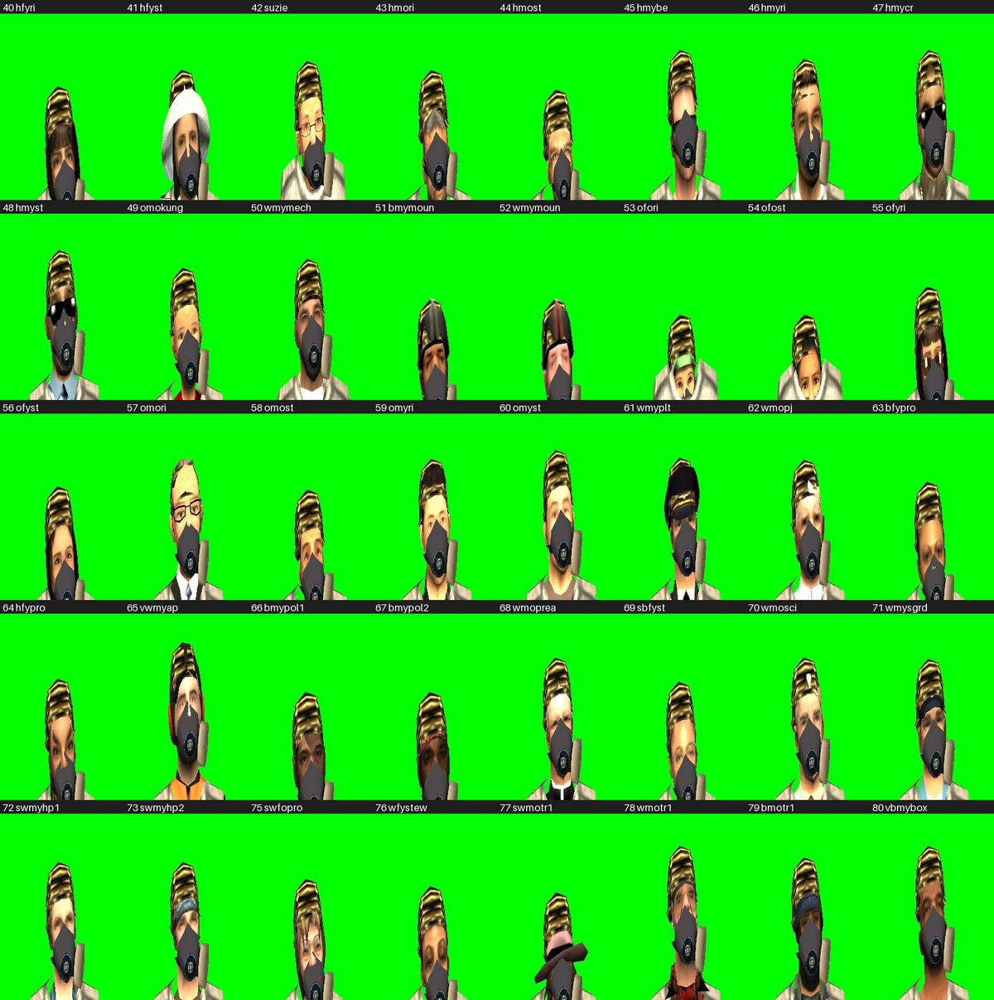
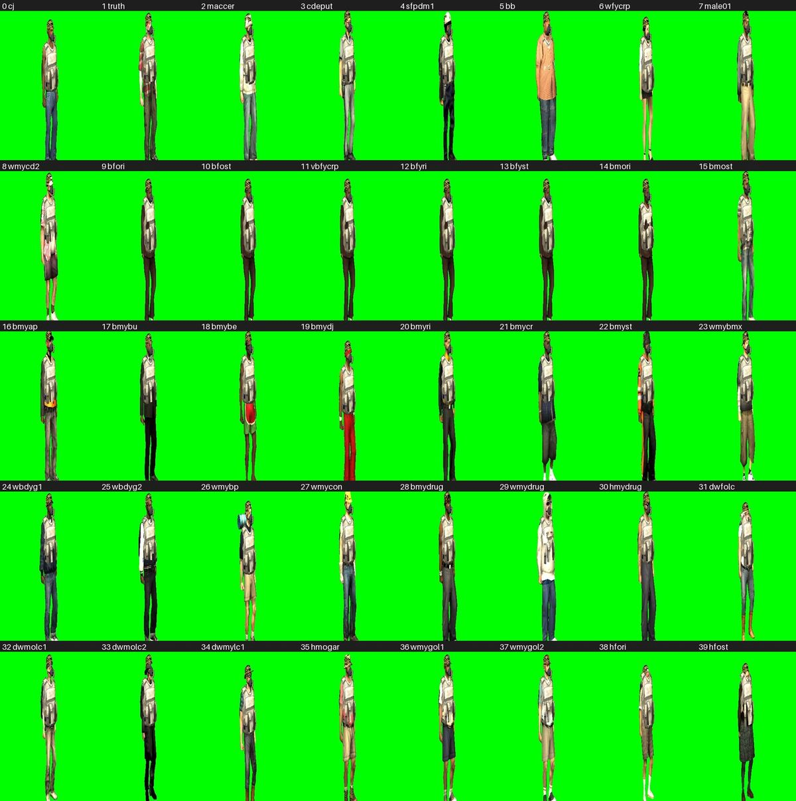
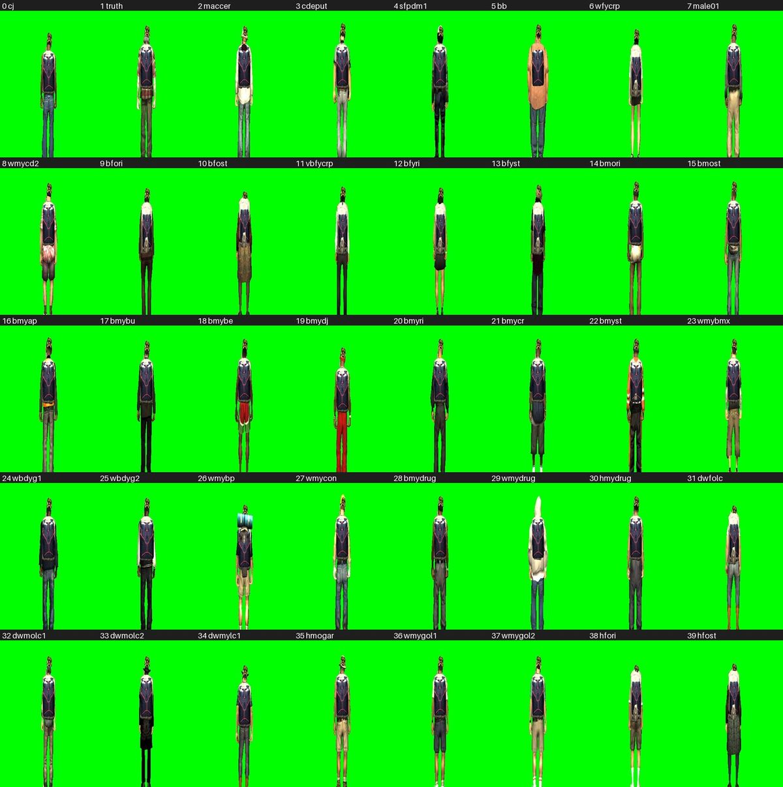
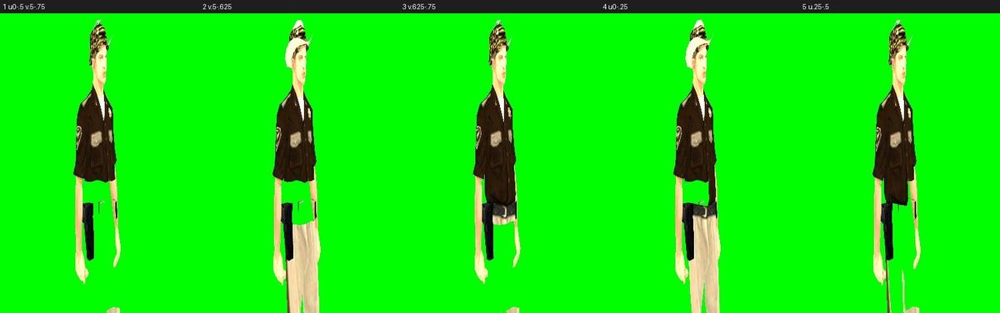
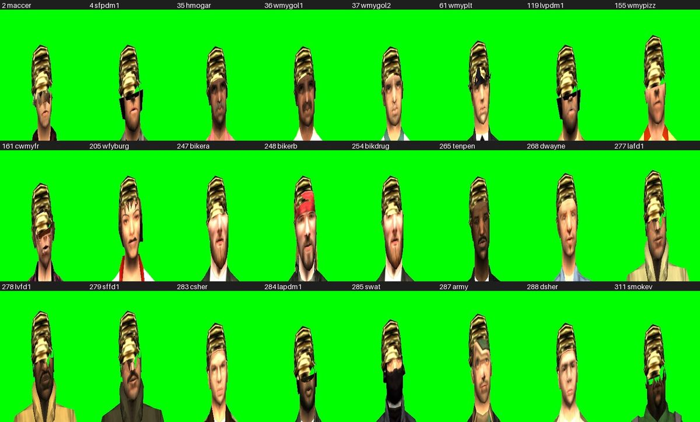
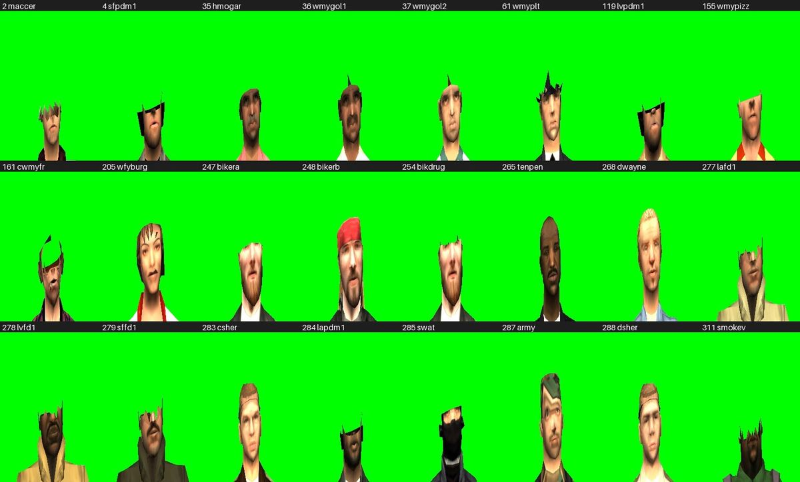

# Worn gear on every human ped model, 2026-10-23

Follow-up to the spawn-skin fit review (2026-10-23-apparel-fit.md) for #72: a skin upstream never tuned an item
for used to get a generic row (hats, masks, armour: `DEFAULTS`) or the lowest tuned skin's row (bags: skin 22's,
a man's, on every untuned woman). Now `items/shared/logic/skins.lua` gives every one of the 310 human ped models
a gender and a build class, and an untuned skin borrows the first donor in its class's chain that has a row
(commit d98c354).

## Method

The dev studio (docs/dev-studio.md) with client `VIRUXE` driven through `rcon.ps1`. One `lua` chunk walks all
310 models on a 1.5 s timer, `setElementModel` then `takePlayerScreenShot` 0.9 s later, so each view is one HTTP
call and one pass takes about eight minutes. The ped wears HelmArmy, GasMask, Armour and Backpack through element
data. Three views: `face` (hat and mask), `threequarter` (armour) and `back` (bag). The 400x600 shots were tiled
into contact sheets with a PIL script and read by eye; a first set of sheets was shot before the change for the
masks and bags "before" row below.

Upstream's rows differ little per skin for hats (HelmArmy is the same nine numbers on all 17 skins) and masks
(x within 0.035, scale within 15 %), more for armour and bags (body shape). So the donor choice matters for the
chest and back, and gender matters most of all.

## Findings

| # | Finding | Fix |
| :--- | :--- | :--- |
| 1 | Hat, mask and vest sit right on all 310 models, women included; before, every untuned woman wore a man's bag row (skin 22's) and the generic mask row sat inside the head | Gender and build chains in `skins.lua` (d98c354) |
| 2 | The heavy men (Big Bear 5, 15, bodyguards 24 and 25, 57, 95, 168, 253, Big Smoke 269, 308) wear the average man's vest a size small | `BUILD` sends them to the mechanic's rows (skin 50, upstream's widest) |
| 3 | About thirty skins carry headgear in their mesh (sheriffs 283/288, army 287, SWAT 285, fire helmets 277-279, police caps 4/265/284, hard hats 35/268, pizza, burger and chicken outfits, bikers 247/248/254, cowboy 161, pilot 61, ...). A worn hat sits on the head bone and the built-in one pokes through | No offset can fix it. Tried and ruled out: a pixel shader discarding the headgear by UV block (`dxCreateShader(src, 0, 0, false, "ped")` on `engineApplyShaderToWorldTexture`): the sheriff's hat is textured from the same atlas block as his trousers, so every rectangle that removes the hat strips the legs (image below). Proven instead: a hatless DFF cut in Blender with DragonFF (faces above the head bone in the hat's UV block, 60 of 1218 triangles), loaded with `engineLoadDFF` and `engineReplaceModel`; the helmet then sits clean. Tracked as #75 |
| 4 | Two shots of the first three-quarter pass (111 and 112) never uploaded | Reshot by hand; the pass loop takes `takePlayerScreenShot` failures silently |

Face view, models 40 to 80 (helmet and gas mask on every skin):

Three-quarter and back views, models 0 to 39 (vest and backpack):

The UV-clip attempt on the sheriff: every rectangle that removes the hat removes the trousers.

## Hatless twins (#75)

The 24 skins in `HEADGEAR` (tools/extract_ped_models.py) got a twin with the headgear cut away; `items` shows it
under a worn hat. All 24 are clean under the army helmet (left). Bare (right, the twin forced on the client), only
the ones whose cut rim is one loop got a closed skull (sheriffs, army, hard hat, pizza, cowboy, burger, SWAT, the
bikers), and a closed skull is a flat cap of hair texture; close-fitting caps (pilot 61, police 4/119/284, golfers,
Smoke, maccer) leave a cut band. So the twins stay hat-only until the skulls are remodelled by hand in Blender.

## Not covered

- Held items and holsters, which have one row per item type and no per-skin data upstream.
- The spawn pool and the clothes item still use upstream's 14 spawn skins; widening them is a separate decision.
  (Since widened by #76 to upstream's 29 clothes types, see 2026-10-23-clothes.md.)
- Custom `engineRequestModel("ped")` skins get a fresh id above 312 at run time, so `skins.lua` has no gender
  for them: they fall into the average man's chain until a `FEMALE` or `BUILD` entry exists.
