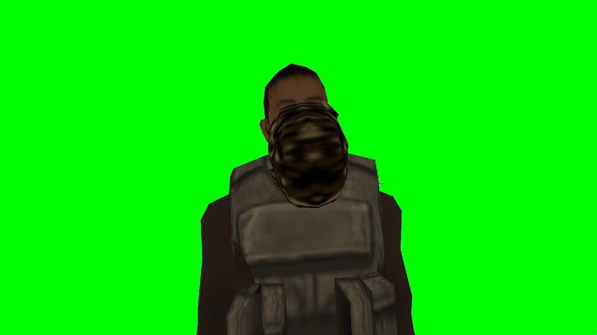
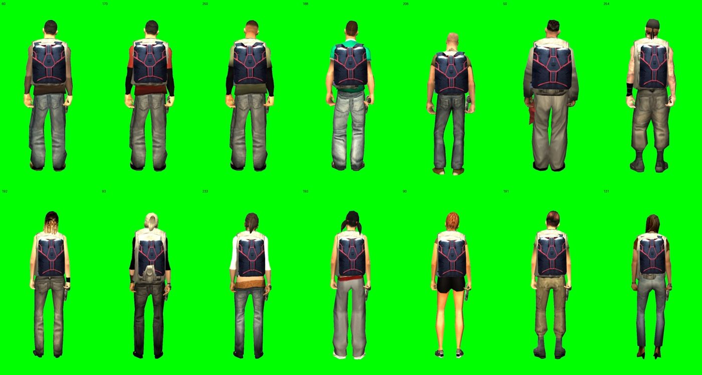
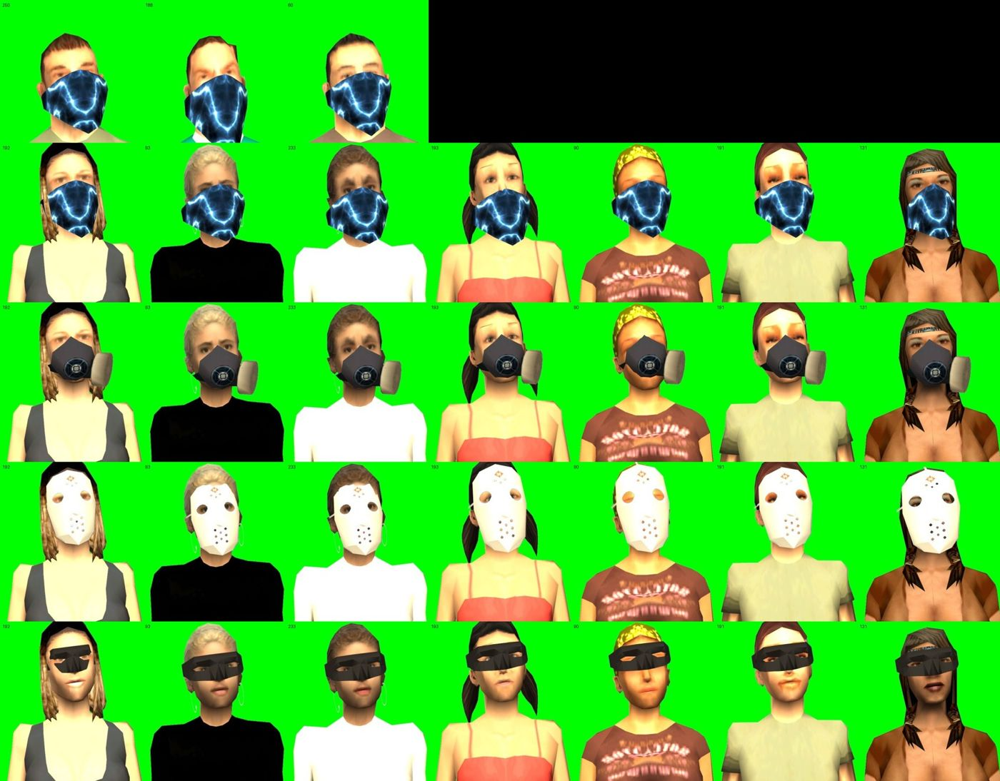
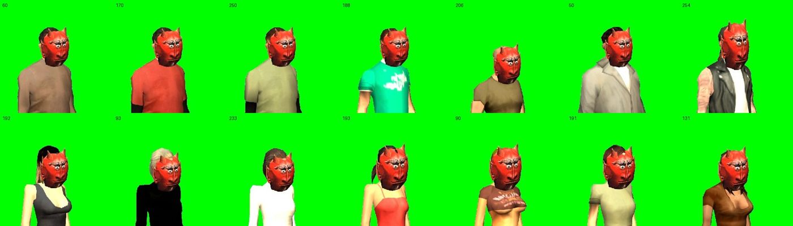

# Apparel fit on every spawnable ped, 2026-10-23

This review checked hats, masks, armour, bags, holsters and held items on all 14 spawn skins in the dev studio
(docs/dev-studio.md), with client `VIRUXE` driven through `rcon.ps1`. Bug #70 tracks it, and it follows up #38,
whose live check (2026-10-23-live-checks.md) had passed attachments that were in fact misplaced. The fix is commit
d86bb2d.

## Findings

| # | Finding | Cause | Fix |
| :--- | :--- | :--- | :--- |
| 1 | Hats and masks floated in front of the face | SA-MP bone 2 was mapped to GTA node 8 (face, X forward) | Node 5, the head pivot (X up the skull) |
| 2 | One offset for every skin | Upstream's `Set{Hat,Mask}OffsetsForSkin` / `ArmourSkinData` were never ported | Converter writes `wearOffsets` per ped model |
| 3 | Spawn skins had no upstream data | MVP placeholders 7 20 21 22 23 50 / 12 13 40 41 56 69 | Upstream's 60 170 250 188 206 50 254 / 192 93 233 193 90 191 131 |
| 4 | Hats sat low on 93, the cap on 193 looked off | Upstream renumbered Civ1F–Civ4F after tuning; the rows kept their symbols | Rows follow their `// <model>` tuning comment |
| 5 | Armour row order differs from its index | `ArmourSkinData` is listed out of clothes-index order | Rows follow their `// skin_X` tag |
| 6 | Beanie, StrawHat, CaptainsCap, SwatHelmet, PizzaHat, PussyMask, DevilMask misplaced (DevilMask several times head size) | Upstream never made them wearable | `BORROW`: donor rows plus own rotation, shift and scale |
| 7 | Skin 90 had no hat or mask rows | Upstream never tuned it (it could not wear hats there) | `SKIN_LIKE[90] = 193` |
| 8 | Nose through the bandana on 250 and 188; bandanas below the nose on the women; Zorro on 192's nose | Upstream rows | `NUDGE` per skin |
| 9 | Ped died during a long studio session | The survival tick kept starving the frozen ped | The studio holds hp and food |

## Intentional deviations (ADR 0007)

- Female hat and mask rows go to the model named in their tuning comment, not to their symbol's current model.
  Upstream put the 65-tuned row on 93, the 93 row on 233, and so on.
- Armour rows are matched by skin tag, not by array index.
- All 7 male and 7 female spawn skins are reachable. Upstream's `random(6)` never picked the 7th.
- Skin 90 can wear hats and masks. Upstream's `DefineClothesType` refused it, but the port enforces no per-skin
  wear flags.
- Wearables upstream never placed have hand-tuned positions.

## Evidence

Before: generic offsets on the face node, skin 60.

Vest, Backpack and thigh-holstered M9 on all 14 skins, from the three-quarter and back views:

Masks on the women after the nudges. The first row shows 250, 188 and 60 with the bandana:

Two of the hand-tuned wearables across all skins:

Held items checked on skin 60: Wrench, Bottle, Medkit, Burger, Crowbar, GasCan, MediumBox, Screwdriver,
Flashlight and Radio, all in the right hand. The back-holstered AK hangs diagonally across the back.

## Not covered

- Held items and holsters on skins other than 60. They use one row per item type, so skin does not change them.
- Weapons drawn by GTA itself (`baseWeapon > 0`), and the MediumBox two-handed carry, which needs the server's
  carry animation.
- Non-spawn skins (admin duty skins, clothes items) fall back to `DEFAULTS`.

## Tooling added along the way

- The studio got a camera-following key light plus a fill, a survival hold, and hides chat.
- Screenshots now come from a PowerShell `PrintWindow` capture of the client window, about 2.6 s a shot against
  about 7 s with `takePlayerScreenShot`.
- Attachment editor resource: #71, in progress.
