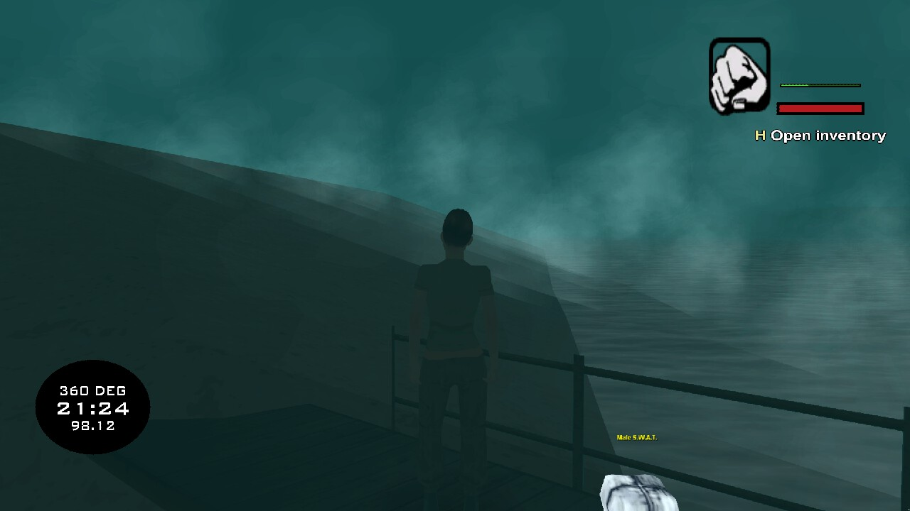

# Clothes item and the spawn pool, 2026-10-23 (#76)

Commits 62da1f5 (clothes item, labels, spawn roll) and 17b679d (death drop). Live check with one client (`VIRUXE`,
character 10, skin 191, a female Military) driven through `rcon.ps1`; smoke step 29.

## What landed

- **Clothes types.** `items/shared/logic/clothes.lua` holds upstream's 29 `DefineClothesType` rows (model, name,
  gender, spawn chance): 15 male, 14 female. A Clothes item stores its skin in `data.skin`. An item created without
  one (loot, drops, crafting, `/additem`) holds a type rolled from its own item id with upstream's rule (each type
  passes its chance, one of the passes is picked), so every creation path is covered and the client label agrees
  with the server without anything writing data until the first swap.
- **Changing clothes.** Using a Clothes item of the character's gender, held or from the inventory, starts a 3 s
  hold timed on the server ("Changing clothes" progress bar), cancelled by moving more than 0.8 m, by death or by
  quitting. The `clothes_swap` procedure then stores the worn skin in the item and the item's skin in
  `characters.skin`. Refused with `CLOTHESWRGE` on the wrong gender and with `CLOTHES_ON_DUTY` on staff duty.
- **Labels.** The inventory row and the ground label read "Male Civilian", "Female Country" and so on; a skin
  outside the table (an older character's) reads "Male Clothes" or "Female Clothes".
- **Spawn pool.** New characters pick a random gender and roll all of its clothes types weighted by their upstream
  spawn chance (`exports.items:rollSpawnSkin`), instead of upstream `spawn.pwn`'s seven skins per gender. Civilians
  come up most of the time; SWAT, Military, Business or Morgan Freeman are rare.
- **Death.** `character_death_drop` now leaves a Clothes item holding the dead character's skin 1 m east of the
  body (upstream `death.pwn` drops it at 90°, which the port had missed) and returns its id as `clothes_item_id`.

## Live check

| Check | Result |
| --- | --- |
| 29b label on the ground | `/additem Clothes` rolled "Male S.W.A.T."; the ground label reads it (first image). **Pass.** |
| 29c wrong gender | Using the Male S.W.A.T. item as a woman: "Wrong gender for clothes", no bar, skin unchanged. **Pass.** |
| 29c change | Held item's data set to skin 93 (Female Civilian) through `lua`: the 3 s bar showed (second image), then the skin became 93; item data in the server state and in the database `{"skin":191}`, `characters.skin` 93. **Pass.** |
| 29c cancel by moving | A second change, the player moved 2 m mid-hold: the bar stopped and the skin stayed 93. **Pass.** |
| 29a spawn roll | Not run (needs a new character). Covered by `tests/lua/spec/items_clothes_spec.lua`. |
| 29b inventory row label, label after pickup, drop and restart | **Not run.** |
| 29c relog keeps the new skin | **Not run**; `characters.skin` was checked in the database instead. |
| 29c refused on staff duty | **Not run.** |
| 29d death drop | **Not run**: a live death would have killed the user's character. Covered by `tests/sql/test_item_graph.py` and `tests/sql/test_clothes.py`. |

The progress bar over the ped while the hold runs:

## Deviations from upstream

- Upstream's `canWearHats` and `canWearMasks` columns are not carried. Every human ped model wears gear through
  `items/shared/logic/skins.lua` (#72), and the four headgear skins in the pool (biker 254, cop 283, SWAT 285,
  military 287) have hatless twins (#75), shown only while a hat is worn; bare, they keep their built-in headgear.
- Changing clothes is refused on staff duty (port only): going off duty restores the pre-duty skin, which would
  undo or duplicate the swap.
- The spawn pool is the 29 clothes types instead of `spawn.pwn`'s 14 skins, so the upstream bug "skin 6
  unreachable" is moot.
