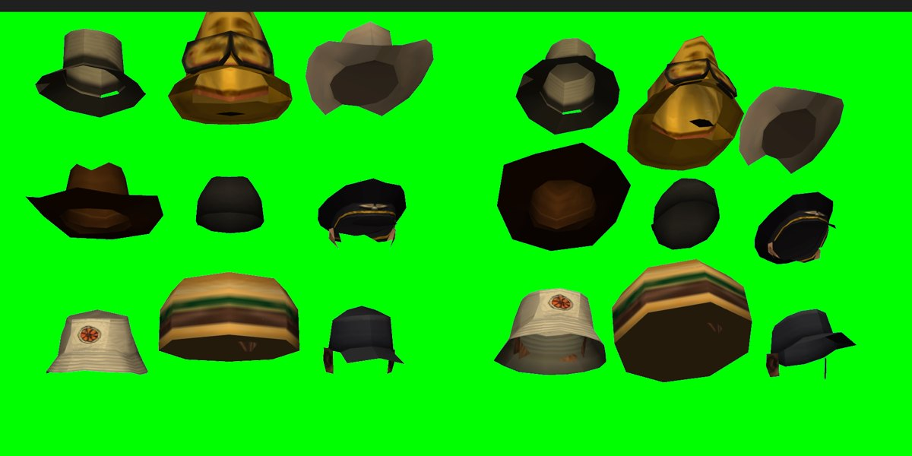

# Hats cut off the headgear skins, 2026-10-25

This closes #77. Nine hat items are cut from GTA skins that model their own headgear: SheriffHat (csher, skin 283),
FireHelmet (lafd1, 277), GardenerHat (hmogar, 35), PilotCap (wmyplt, 61), MotoHelmet (bikera, 247), RanchHat
(cwmyfr, 161), GolfCap (wmygol1, 36), BurgerHat (wfyburg, 205) and BucketHat (maccer, 2). They are loot items
with port model ids 20001 to 20009 and are worn on the head of any skin.

## Method

Checked live on the dev server with client `VIRUXE` on skin 93, and in Blender 5.2 with DragonFF.

`python -m tools.extract_ped_models --hats` builds the hats from the rows of `tools/port_hats.py`: uname, display
name, skin, ped DFF, loot tables with weights and the atlas `blocks`. The ids live in `models/hats.lua` (`dff`,
`txdModel` is the skin, `col` is the shared "beanie1" collision, `dist` 100). The files are
`models/files/<ped>_hat.dff`, loaded by `models/client/main.lua` like the SA-MP models, through
`exports.models:resolve(id)`.

The item types are generic, size 1 and roty 270, so the X-up mesh stands on the ground. They come from
`add_port_hats` in `tools/convert/item_types.py`. Loot rows come from `add_port_hats` in
`tools/convert/loot_tables.py`:

- Sheriff hat: world_police 12, vehicle_police 10.
- Fire helmet: world_industrial 10, vehicle_industrial 8.
- The rest: world_civilian at 4 to 10. The moto helmet is also in vehicle_civilian at 8. The bucket hat is also in world_survivor at 6.

In `items/shared/logic/apparel.lua` the `CUT_HATS` set is worn on SA-MP bone 2. `CUT_HAT_FIT` holds per-skin rows,
borrowed along the `skins.lua` chain: [283] is the zero row, [93] is scale 1.1 at zero offset.

The export is `export_hat` in `tools/blender/remodel_head.py`, run per hat with `--only hats --blocks c,r;c,r`:

- The faces the HEADS rule deletes from the skin are copied into a new mesh.
- They are expressed in the Head bone's bind frame. DragonFF rebuilds the bone from the skin's inverse bind matrix.
- For every skin checked the Head bind rotation is within 6 degrees of identity, so this is a translation to the bone origin.
- Only faces whose UV centre falls in the row's atlas `blocks` are kept.
- Normals are recalculated and every face is duplicated with reversed winding, a double-sided shell.
- The result is exported as a static DFF with the skin's texture name.

Screenshots come from capturing the client window with PowerShell (`System.Drawing` PrintWindow), not
`takePlayerScreenShot`. Blender is the faster place to look at the mesh, with a headless render and culling on. The
game is for the TXD binding, the bone frame and the final fit.

## Findings

| # | Finding | Fix |
| :--- | :--- | :--- |
| 1 | The fit looked pitched back from the studio's face and three-quarter presets. Against the native sheriff skin from the side, the attached hat matched the native hat within 2 px at 800x1200. The presets look at the brim from below | None in code. Judge hats from the side camera (`studio 
 270 1.4 0.75 0.65`) or a head-level custom camera, and from six angles |
| 2 | GTA models a skull patch under its hats, textured with a smear of the face. The cut carried it and it showed through the open bottom, a face inside every hat, visible on the ground and from below. A ray test for inside faces failed, because the patch is the floor, not the inside | Per-hat atlas `blocks` in `port_hats.py`, read off a sheet of the nine textures with the 8x8 grid drawn. On the sheriff, 122 of 290 faces dropped |
| 3 | Faces of a ped mesh are wound every which way, since peds are drawn without back-face culling. As an object the crowns were see-through. Recalculating normals made free-standing hats solid, but worn hats vanished to slivers, because MTA culls an attached object on the opposite side from a free-standing one. `setElementDoubleSided` fixed the worn one. `engineSetModelFlag` "no_backface_cull" did not visibly change it | The exporter makes the shell double-sided, every face twice and reversed, for a few hundred extra triangles per hat. Solid from all six angles, worn and alone |
| 4 | Skin 93's hair fills a hat cut from a flat male head. Lowering 2 cm at scale 0.9 pushed hair through the crown on the side and back views | `CUT_HAT_FIT[93]` is scale 1.1 at zero offset. Clean on the rancher and golf cap, with a sliver of hair at the back of the sheriff's crown |
| 5 | Blender is the faster place to look at the mesh. The game is only needed for the TXD binding, the bone frame and the final fit | Workflow note, now in `docs/runbooks/add-hatless-skin.md` |
| 6 | Alone on the green screen from five angles, after the block filter: the sheriff's crown had no front, the gardener's brim a hole, the pilot's cap and the golf cap skin and hair flaps, the bucket hat a notch in its crown. Each is one atlas block; coloured by block in Blender (one material per block, four views) the skull patch sits well inside the crown's radius and the shell on it | Sheriff keeps 5,5 and 3,6 and drops 0,7; gardener keeps 5,4; pilot drops 3,5; golf drops 5,4; the bucket hat's block 1,4 counts as hat only from 0.13 m up (`above` in the row) |

The nine hats worn on skin 93, head-level three-quarter camera:

The nine hats alone in the studio, front and low views:

## Not covered

- Fit rows for skins other than 5, 93, 131 and 283. The remaining skins still borrow along the `skins.lua` chain
  and were not checked.
- The `_T` descriptions in the language files. The port does not use them.
- Other headgear a SA-MP object already covers (police caps, army helmets, beanie) is also left out.
- Cuts that are mostly hair (dwayne's mullet, bikerb's bandana) are left out on purpose.

## Studio fit follow-up (#88, 2026-10-25)

The dev client was checked in the studio from front, three-quarter, both sides, back and top. On heavy male skin 5,
the default GolfCap fit left the crown cutting into the head. A preview at `{ 0.015, 0, 0, 0, 0, 0, 1.2, 1.2, 1.2 }`
covered the crown and kept the brim clear of the eyes; this row is now in `CUT_HAT_FIT` and is inherited by heavy
male skins through `skins.lua`. Heavy female skin 131 was checked at the same six angles; scale 1.05 sat cleanly on
the hairline and is now its own row, since it should not inherit 93's larger 1.1 scale. The GolfCap's rear opening
is now closed along the crown; hair below its rear band belongs to the wearer. Additional spot checks on other
female and heavy skins remain open.

## Mesh cleanup follow-up (#88, 2026-10-25)

`tools/blender/remodel_head.py` now closes the crown-back loops on the GolfCap and Sheriff's Hat, mapping the cap
faces from the boundary UVs. It also removes the isolated fire-helmet triangle below the brim and the three
single-face bucket-hat strands behind the brim. The two pairs of meshes were rebuilt with
`python -m tools.extract_ped_models --hats 36 283` and `--hats 2 277`, then checked in the live studio from back and
side. The Blender wrapper now treats traceback text as a failed export even if Blender leaves an older DFF in place.

## SWAT and pizza object decision (#88, 2026-10-25)

The dev studio check on skins 285 and 155 showed the existing `SwatHelmet` (19514) and `PizzaHat` (19558) models
fit their uniforms from the front and back. Keep these SA-MP object models; duplicate skin-cut assets would not
address the rear hair openings and would add two more streamed models to maintain. The separate cleanup of the
fire helmet and bucket hat blocks is recorded above.
