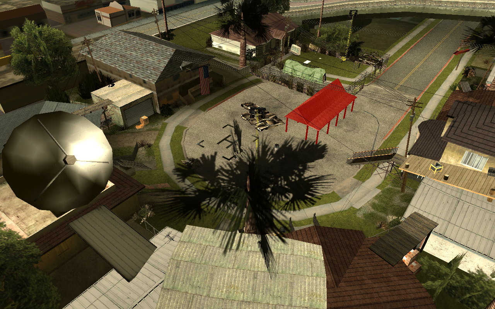
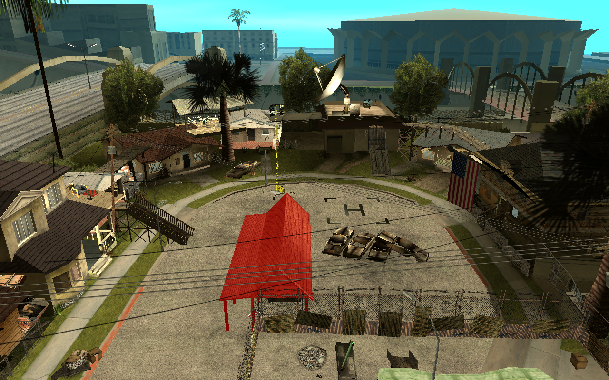
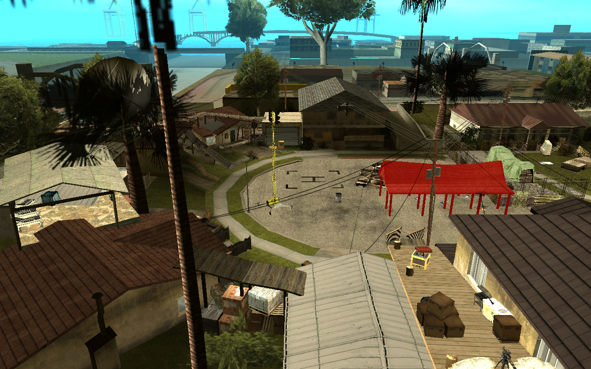
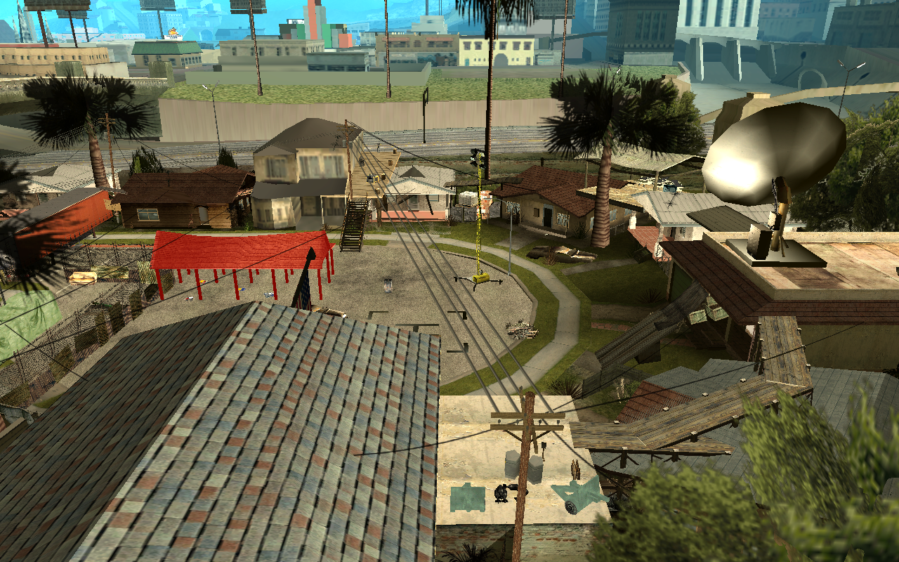
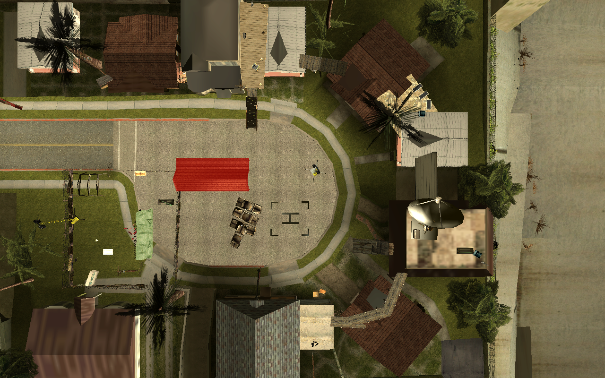

# LS/Fort Defiance: survey

Generated by `python -m tools.fort_survey "LS/Fort Defiance"`; the `proposal` column is meant to be edited.

205 rows, 15 clusters (single linkage, gap 1.0 m). `protrudes` = collision box overlaps a native building's box by more than 0.05 m3 (an upper bound; LODs, roads, ground, plants and poles are ignored); `floats` = metres above the highest native top below.

| cluster | rows | models | bbox (x0 y0 z0 .. x1 y1 z1) | role | protrudes | floats | proposal |
| ---: | ---: | --- | --- | --- | --- | ---: | --- |
| 1 | 1 | 11435 | 2442 -1654 12 .. 2449 -1648 20 | landmark | dyn_f_r_wood_1b, starthootra1_lae | 0.0 | keep helipad, drop the rest |
| 2 | 111 | 850 854 923 925 944 955 956 964x2 1230 1271 1342 1348 1349 1413 1447 1452x4 1457 1458 1464 1541 1544x2 1546 1551 1645 1663 1676 1712 1720 1722 1735 1771 1797 1804 1805 1811 1812 1951 2012 2035x2 2036 2037x2 2040 2041 2042 2043 2044x2 2062 2069 2096 2115 2147 2190 2213 2222 2226x2 2314 2453 2514x4 2600 2636x2 2670 2673 2674 2677 2724 2788 2829 2836 2843 2844 2845 2846 2905x2 2906x3 2907x2 2908x2 3066 3569 3790 3793 3928 4100 7090 8167 8877 11474x2 13591 14604 14861 16370 16405 17010 | 2450 -1693 9 .. 2504 -1645 25 | furniture/loot | carlshou1_lae2, dyn_mesh_05, ganghous02_lax, gen_doorext03, la_fuckcar2, rydhou01_lae2 | 0.0 | drop |
| 3 | 1 | 849 | 2473 -1654 12 .. 2476 -1651 13 | junk | cardboardbox | 0.0 | keep (ground level) |
| 4 | 2 | 1358 2929 | 2477 -1648 13 .. 2480 -1643 17 | junk | dyn_mesh_05, ganghous02_lax, mcstraps_lae2 | 0.0 | keep (ground level) |
| 5 | 32 | 964 974 1264 1265 1299 1369 1431 1481 1558 1685 1704 1714 2036 2045 2060x10 2136 2764 2985 3361 3576 3577 11496 16502 | 2488 -1656 8 .. 2512 -1631 20 | furniture/loot | blackbag2, cardboardbox, compfukhouse3, dyn_mesh_05, ganghous01_lax, mcstraps_lae2 | 0.0 | drop |
| 6 | 1 | 1362 | 2497 -1667 12 .. 2498 -1666 14 | junk | - | 0.0 | keep (ground level) |
| 7 | 1 | 1764 | 2503 -1693 17 .. 2505 -1691 18 | furniture/loot | - | 0.0 | drop |
| 8 | 23 | 1449 1636x5 1672x2 1777 2033 2034 2061x4 2064x2 2228 3035 3406x4 | 2503 -1700 9 .. 2523 -1684 19 | furniture/loot | cjsaveg, dyn_f_wood_3, ganghous05_lax, sweetshou1_lae2 | 0.0 | drop |
| 9 | 1 | 8879 | 2503 -1667 12 .. 2508 -1662 25 | tower | - | 0.0 | kit tower |
| 10 | 2 | 2900 2926 | 2505 -1690 13 .. 2508 -1689 14 | furniture/loot | - | 0.0 | drop |
| 11 | 2 | 851 852 | 2507 -1676 12 .. 2510 -1673 13 | junk | - | 0.0 | keep (ground level) |
| 12 | 6 | 1245 1503 1595 1739 3393 11327 | 2513 -1682 12 .. 2531 -1661 30 | furniture/loot | compfukhouse3, sweetshou1_lae2 | 0.0 | drop |
| 13 | 18 | 1369 1997x3 2044 2057 2059 2709x5 2976 2977 3095 3386 3392 3403 | 2517 -1659 17 .. 2530 -1644 23 | furniture/loot | compfukhouse3, ganghous01_lax | 4.7 | drop |
| 14 | 3 | 2977 2985 3795 | 2532 -1683 19 .. 2538 -1679 20 | furniture/loot | sweetshou1_lae2 | 0.0 | drop |
| 15 | 1 | 3260 | 2534 -1671 14 .. 2535 -1669 17 | perimeter | sweetshou1_lae2 | 0.0 | kit wall / corner / barricade |

## Models

| model | rows | dff | txd | collision box (m) |
| ---: | ---: | --- | --- | --- |
| 2060 | 10 | cj_sandbag | cj_ammo | 1.2 x 0.5 x 0.3 |
| 1636 | 5 | rcbomb | rcbomb | 0.7 x 0.7 x 0.7 |
| 2709 | 5 | pain_killer | pick_up | 0.2 x 0.2 x 0.3 |
| 1452 | 4 | dyn_outhouse | break_street2 | 1.1 x 1.2 x 2.1 |
| 2514 | 4 | cj_toilet1 | cj_bathroom | 0.4 x 0.6 x 0.9 |
| 3406 | 4 | cxref_woodjetty | cxref_desert | 8.8 x 2.2 x 8.2 |
| 2061 | 4 | cj_shells1 | cj_ammo | 0.3 x 0.1 x 0.6 |
| 964 | 3 | cj_metal_crate | cj_crate_will | 1.3 x 1.3 x 1.0 |
| 2044 | 3 | cj_mp5k | cj_ammo | 0.3 x 0.2 x 0.1 |
| 2906 | 3 | kmb_deadarm | dead_mantxd | 0.2 x 0.6 x 0.2 |
| 1997 | 3 | hos_trolley | hos_trolley | 0.9 x 2.0 x 1.2 |
| 11474 | 2 | des_swtfence2 | des_wtownmain | 3.0 x 0.4 x 1.7 |
| 2636 | 2 | cj_pizza_chair | pizza_furn | 0.5 x 0.5 x 1.3 |
| 1544 | 2 | cj_beer_b_1 | cj_bar | 0.1 x 0.1 x 0.4 |
| 2037 | 2 | cj_pistol_ammo | cj_ammo | 0.2 x 0.1 x 0.1 |
| 2035 | 2 | cj_m16 | cj_ammo | 1.0 x 0.2 x 0.1 |
| 2036 | 2 | cj_psg1 | cj_ammo | 1.2 x 0.3 x 0.1 |
| 2985 | 2 | minigun_base | minigx | 1.2 x 0.4 x 1.4 |
| 2977 | 2 | kmilitary_crate | k_militbx | 1.6 x 1.3 x 1.1 |
| 2064 | 2 | cj_feildgun | cj_ammo | 1.3 x 2.6 x 1.3 |
| 1672 | 2 | gasgrenade | gasgren | 0.4 x 0.4 x 0.4 |
| 2226 | 2 | low_hi_fi_3 | cj_hi_fi2 | 0.8 x 0.3 x 0.3 |
| 1369 | 2 | cj_wheelchair1 | cj_street_props | 0.9 x 1.2 x 1.3 |
| 2908 | 2 | kmb_deadhead | dead_mantxd | 0.2 x 0.2 x 0.2 |
| 2907 | 2 | kmb_deadtorso | dead_mantxd | 0.5 x 0.9 x 0.3 |
| 2905 | 2 | kmb_deadleg | dead_mantxd | 0.4 x 0.8 x 0.2 |
| 3569 | 1 | lasntrk3 | dockcargo2_las | 3.6 x 17.7 x 5.1 |
| 854 | 1 | cj_urb_rub_3b | junkpiles | 2.9 x 2.4 x 0.4 |
| 1358 | 1 | cj_skip_rubbish | break_s_bins | 4.4 x 3.0 x 2.4 |
| 16370 | 1 | by_fuelfence | des_boneyard | 32.2 x 33.0 x 4.3 |
| 1413 | 1 | dyn_mesh_3 | break_f_mesh | 5.3 x 0.3 x 2.6 |
| 1447 | 1 | dyn_mesh_4 | break_f_mesh | 5.3 x 0.3 x 2.6 |
| 3260 | 1 | oldwoodpanel | country_breakable | 2.0 x 0.1 x 3.0 |
| 850 | 1 | cj_urb_rub_1 | junkpiles | 3.2 x 4.4 x 0.2 |
| 849 | 1 | cj_urb_rub_3 | junkpiles | 2.8 x 2.4 x 0.6 |
| 852 | 1 | cj_urb_rub_4 | junkpiles | 2.6 x 2.2 x 0.6 |
| 851 | 1 | cj_urb_rub_2 | junkpiles | 2.5 x 2.8 x 0.6 |
| 3577 | 1 | dockcrates1_la | sjmla_las | 3.2 x 3.3 x 1.6 |
| 3576 | 1 | dockcrates2_la | sjmla_las | 4.1 x 3.0 x 3.0 |
| 1431 | 1 | dyn_box_pile | break_s_box | 2.1 x 0.7 x 1.1 |
| 1685 | 1 | blockpallet | blokpalet | 1.8 x 1.8 x 1.5 |
| 1362 | 1 | cj_firebin_(l0) | cj_bins | 0.8 x 0.7 x 1.2 |
| 3035 | 1 | tmp_bin | tmbinx | 2.2 x 1.4 x 1.5 |
| 2926 | 1 | dyno_box_a | dyno_box | 1.2 x 0.8 x 0.5 |
| 2900 | 1 | temp_cardbox | kmb_alleytxd | 1.1 x 1.0 x 1.4 |
| 1777 | 1 | cj_cooker1 | cj_commercial | 0.6 x 0.9 x 1.6 |
| 1449 | 1 | dyn_crate_2 | break_pallet | 2.2 x 0.6 x 1.1 |
| 974 | 1 | tall_fence | fences | 6.7 x 0.6 x 5.6 |
| 1811 | 1 | med_din_chair_5 | cj_tables | 0.8 x 0.7 x 1.3 |
| 4100 | 1 | meshfence1_lan | lanfireesc_tr | 10.6 x 8.9 x 2.9 |
| 8167 | 1 | apgate1_vegs01 | vgssmulticarprk | 0.1 x 7.5 x 2.5 |
| 1720 | 1 | rest_chair | cj_seating | 0.5 x 0.6 x 1.0 |
| 1805 | 1 | cj_barstool | cj_seating | 0.5 x 0.5 x 0.5 |
| 2096 | 1 | cj_rockingchair | cj_seating | 0.5 x 0.7 x 1.0 |
| 2724 | 1 | lm_stripchair | lee_txd | 0.6 x 0.7 x 1.1 |
| 2012 | 1 | shop_shelf13 | shop_shelf1 | 3.0 x 1.0 x 2.0 |
| 1735 | 1 | cj_easychair1 | cj_seating | 0.9 x 0.9 x 1.3 |
| 2453 | 1 | cj_pizza_dispf | cj_ff_acc1 | 0.5 x 0.5 x 0.8 |
| 1342 | 1 | noodlecart_prop | foodkarts | 1.6 x 2.3 x 2.5 |
| 2600 | 1 | cj_view_tele | external | 0.4 x 1.0 x 1.6 |
| 956 | 1 | cj_ext_candy | cj_ext_vend2 | 1.2 x 0.8 x 2.2 |
| 955 | 1 | cj_ext_sprunk | cj_ext_vend | 1.2 x 0.9 x 2.2 |
| 2314 | 1 | cj_tv_table3 | cj_tv_stand | 2.4 x 0.9 x 0.5 |
| 1541 | 1 | cj_beer_taps_1 | cj_bar | 0.9 x 0.1 x 0.7 |
| 1546 | 1 | cj_pint_glass | cj_bar | 0.1 x 0.1 x 0.2 |
| 1551 | 1 | dyn_wine_big | cj_bar | 0.1 x 0.1 x 0.5 |
| 1951 | 1 | kb_beer01 | kbeer | 0.1 x 0.1 x 0.4 |
| 2213 | 1 | burgerlow | burger_tray | 0.6 x 0.6 x 0.4 |
| 2222 | 1 | rustyhigh | donut_tray | 0.4 x 0.6 x 0.1 |
| 2788 | 1 | cj_burg_chair | pizza_furn | 0.6 x 0.5 x 1.1 |
| 923 | 1 | packing_carates2 | crates_n_stuffext | 1.9 x 1.1 x 1.8 |
| 3066 | 1 | ammotrn_obj | ammotrx | 2.8 x 10.7 x 2.6 |
| 925 | 1 | rack2 | crates_n_stuffext | 2.4 x 1.7 x 2.1 |
| 1271 | 1 | gunbox | gunbox | 0.7 x 0.8 x 0.7 |
| 944 | 1 | packing_carates04 | crates_n_stuffext | 3.0 x 1.5 x 1.4 |
| 1348 | 1 | cj_o2tanks | cj_street_props | 1.6 x 0.9 x 1.4 |
| 2062 | 1 | cj_oildrum2 | cj_ammo | 0.8 x 0.7 x 1.2 |
| 2147 | 1 | cj_kitch1_fridge | cj_kitchen | 1.0 x 0.8 x 4.0 |
| 2836 | 1 | gb_livingrug05 | gb_rugs01 | 2.0 x 1.1 x 0.0 |
| 2829 | 1 | gb_platedirty02 | gb_dirtycrock01 | 0.5 x 0.5 x 0.1 |
| 13591 | 1 | kickcar28 | kickstart | 11.1 x 7.1 x 6.3 |
| 2677 | 1 | proc_rubbish_7 | proc_rub | 2.4 x 2.6 x 0.6 |
| 2674 | 1 | proc_rubbish_2 | proc_rub | 1.5 x 1.5 x 0.1 |
| 2673 | 1 | proc_rubbish_5 | proc_rub | 1.5 x 1.3 x 0.2 |
| 2670 | 1 | proc_rubbish_1 | proc_rub | 2.5 x 1.1 x 0.2 |
| 1230 | 1 | cardboardbox | boxes | 0.8 x 0.8 x 0.8 |
| 1349 | 1 | cj_shtrolly | cj_dyn_prop | 1.5 x 0.8 x 1.1 |
| 16405 | 1 | desn2_hutskel03 | desn2_minestuff | 6.1 x 5.0 x 4.0 |
| 17010 | 1 | truth_barn03 | truth_farm | 14.6 x 6.7 x 5.7 |
| 1771 | 1 | cj_bunk_bed1 | cj_beds | 1.3 x 2.6 x 1.3 |
| 1812 | 1 | low_bed_5 | cj_beds | 1.0 x 2.3 x 0.8 |
| 14861 | 1 | choochie-bed | gf1 | 2.5 x 3.0 x 0.9 |
| 2844 | 1 | gb_bedclothes03 | gb_bedroomclths01 | 0.9 x 0.9 x 0.2 |
| 2843 | 1 | gb_bedclothes02 | gb_bedroomclths01 | 0.8 x 0.8 x 0.1 |
| 2845 | 1 | gb_bedclothes04 | gb_bedroomclths01 | 1.1 x 1.2 x 0.1 |
| 2846 | 1 | gb_bedclothes05 | gb_bedroomclths01 | 1.1 x 1.3 x 0.2 |
| 1804 | 1 | med_bed_1 | cj_med_beds | 2.0 x 1.2 x 0.8 |
| 1797 | 1 | swank_bed_3 | cj_s_beds | 1.9 x 2.6 x 1.0 |
| 1712 | 1 | kb_couch05 | kbcouch1 | 2.4 x 1.0 x 1.0 |
| 1663 | 1 | swivelchair_b | policechair | 0.6 x 0.7 x 0.9 |
| 14604 | 1 | tv_stand_bike | drivingbit | 0.8 x 0.7 x 2.0 |
| 1457 | 1 | dyn_outhouse_2 | break_street2 | 3.2 x 3.6 x 3.3 |
| 1458 | 1 | dyn_cart | cart | 1.6 x 3.8 x 1.8 |
| 2040 | 1 | ammo_box_m1 | cj_ammo | 0.2 x 0.4 x 0.2 |
| 2041 | 1 | ammo_box_m2 | cj_ammo | 0.2 x 0.4 x 0.4 |
| 2042 | 1 | ammo_box_m3 | cj_ammo | 0.6 x 0.5 x 0.2 |
| 2043 | 1 | ammo_box_m4 | cj_ammo | 0.2 x 0.7 x 0.2 |
| 3795 | 1 | missile_04_sfxr | missiles_sfs | 3.2 x 1.2 x 0.7 |
| 3793 | 1 | missile_06_sfxr | missiles_sfs | 3.2 x 1.2 x 1.2 |
| 3790 | 1 | missile_01_sfxr | missiles_sfs | 2.9 x 0.4 x 0.4 |
| 1595 | 1 | satdishbig | satdish | 9.6 x 8.4 x 10.6 |
| 3393 | 1 | a51_sdsk_ncol4_ | milbase | 1.3 x 3.5 x 2.0 |
| 1739 | 1 | swank_din_chair_5 | cj_tables | 0.7 x 0.6 x 1.8 |
| 1245 | 1 | newramp | newramp | 5.1 x 3.4 x 3.1 |
| 1503 | 1 | dyn_ramp | ramp1 | 3.3 x 4.6 x 1.9 |
| 2228 | 1 | cj_shovel | bitsnbobs | 0.2 x 0.1 x 1.1 |
| 2034 | 1 | cj_sawnoff | cj_ammo | 0.3 x 0.2 x 0.1 |
| 2033 | 1 | cj_sawnoff2 | cj_ammo | 0.4 x 0.1 x 0.1 |
| 1764 | 1 | low_couch_2 | cj_sofa | 2.3 x 1.0 x 1.0 |
| 2115 | 1 | low_dinning_1 | cj_tables | 2.0 x 1.0 x 0.8 |
| 2069 | 1 | cj_mlight7 | cj_lighting | 0.5 x 0.5 x 2.2 |
| 1645 | 1 | lounge_wood_up | od_beachstuff | 0.8 x 2.3 x 0.6 |
| 2190 | 1 | pc_1 | cj_office | 0.5 x 0.4 x 0.5 |
| 1722 | 1 | off_chairnu | cj_office | 0.6 x 0.6 x 1.0 |
| 8879 | 1 | vgsecnstrct08 | buildingsitevge | 3.3 x 3.3 x 12.2 |
| 8877 | 1 | vgsecnstrct10 | buildingsitevge | 4.5 x 4.5 x 12.2 |
| 16502 | 1 | cn2_jetty1 | des_stownw | 15.3 x 2.8 x 7.0 |
| 11327 | 1 | sfse_hub_grgdoor02 | oldgarage_sfse | 0.1 x 10.2 x 4.2 |
| 11496 | 1 | des_wjetty | des_nwstuff | 7.0 x 16.0 x 6.8 |
| 2929 | 1 | a51_blastdoorl | a51_imy | 4.1 x 0.5 x 3.6 |
| 1676 | 1 | washgaspump | wshxrefpump | 2.1 x 1.3 x 3.2 |
| 11435 | 1 | des_indsign1 | des_clifftown | 5.6 x 4.5 x 7.5 |
| 1464 | 1 | dyn_scaffold_3 | break_scaffold | 2.9 x 1.5 x 2.3 |
| 3361 | 1 | cxref_woodstair | cxref_desert | 8.5 x 2.1 x 9.2 |
| 1704 | 1 | kb_chair03 | kb_parker | 1.1 x 1.0 x 1.0 |
| 1714 | 1 | kb_swivelchair1 | cj_office | 0.6 x 0.8 x 1.2 |
| 2136 | 1 | cj_k3_sink | cj_kitchen | 2.0 x 0.7 x 1.3 |
| 2045 | 1 | cj_bbat_nails | cj_ammo | 0.2 x 0.8 x 0.2 |
| 1558 | 1 | cj_cardbrd_pickup | cj_box1 | 1.0 x 1.0 x 1.0 |
| 1299 | 1 | smashboxpile | boxes | 2.1 x 2.1 x 1.8 |
| 1264 | 1 | blackbag1 | drubish | 0.9 x 1.0 x 0.9 |
| 1265 | 1 | blackbag2 | drubish | 1.0 x 0.9 x 0.7 |
| 2764 | 1 | cj_pizza_table03 | pizza_furn | 1.1 x 1.1 x 0.8 |
| 1481 | 1 | dyn_bar_b_q | break_street2 | 0.9 x 0.6 x 1.4 |
| 7090 | 1 | vegasflag1 | vegasflag | 8.1 x 2.9 x 7.5 |
| 3928 | 1 | helipad | weemap | 8.1 x 7.2 x 0.0 |
| 3095 | 1 | a51_jetdoor | a51jdrx | 9.0 x 9.0 x 0.6 |
| 3403 | 1 | sw_logcover | ce_farmxref | 12.3 x 8.9 x 6.2 |
| 2976 | 1 | green_gloop | gloopx | 0.4 x 0.4 x 0.8 |
| 3386 | 1 | a51_srack2_ | milbase | 1.0 x 1.0 x 3.0 |
| 3392 | 1 | a51_sdsk_ncol3_ | milbase | 1.3 x 3.5 x 1.4 |
| 2057 | 1 | flame_tins | cj_ammo | 0.7 x 0.4 x 0.3 |
| 2059 | 1 | cj_gunstuff1 | cj_ammo2 | 1.0 x 0.6 x 0.0 |

## Captures

