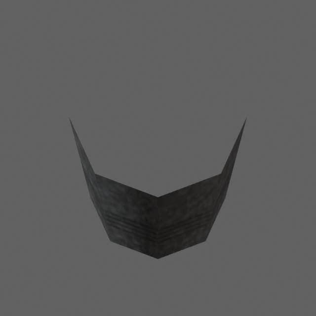
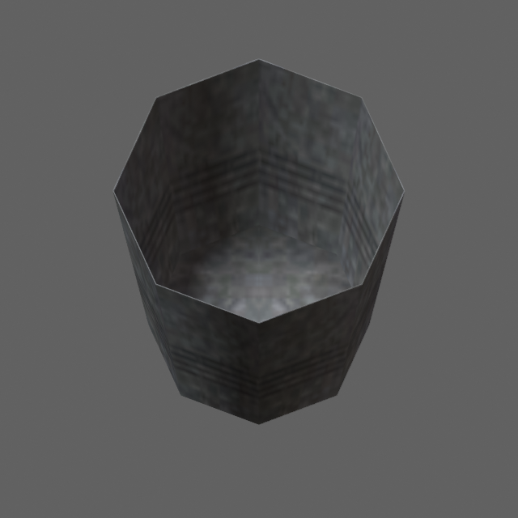

# Bucket model 19468: missing interior

The shipped `samp_models/files/bucket01.dff` is readable, but has only 16
outward-facing wall triangles and eight downward-facing bottom triangles. There
are no faces visible from inside. Backface culling removes the far walls and the
bottom when the dropped item is viewed from above, leaving the shard seen in the
reported screenshot. Its grey corrugated-metal texture is present and correctly
referenced; placement and model resolution are not the cause.

The DFF now includes an inward-facing lining inset by 1 mm, a floor raised by
1 mm, and a narrow rim joining the lining to the original opening. The lining has
separate inverted normals and matching UVs. Actual thickness avoids coplanar
backface/depth artifacts. The original exterior, pivot, bounding sphere, texture
reference and material are preserved. The TXD and COL are byte-for-byte unchanged.
The mesh grows from 41 vertices / 24 triangles to 98 vertices / 64 triangles.

Reproduce the asset rebuild with DragonFF installed:

```powershell
python -m tools.repair_samp_bucket PATH/TO/SAMP.img
# An extracted original bucket01.dff also works as the source.
# Pass --dragonff ADDON_DIR if automatic discovery cannot find gtaLib/.
```

The extractor keeps existing pack files. When extracting into an empty pack,
run this repair afterwards, as documented in `tools/extract_samp_models.py`.

## Verification

Blender 5.3 + DragonFF imported the original and repaired DFF/TXD. Textured
Workbench renders with backface culling enabled at elevations of 35 and 65 degrees
reproduced the reported shard before the repair and showed the complete bucket
afterwards. The images below use the same camera, lighting and culling settings
(65 degrees).

| Before | After |
| :---: | :---: |
|  |  |

DragonFF round-trip validation confirmed all 64 triangles in both the geometry
records and BinMesh. Additional comparisons confirmed the original exterior
vertices, triangles, normals, UVs, bounding sphere and material are preserved;
the TXD and COL match Git HEAD. Rebuilding twice produced identical bytes.
Both modified Python modules compile. `samp_models` luacheck: zero warnings/errors
across five files. Full-resource luacheck: 84 warnings, zero errors; this fix changes
no Lua. StyLua could not run because access to the installed executable was denied.

In-game verification was unavailable: the mandated live settings path does not
exist on this Windows host, and the wrapper's remote mode could not read SSH
known_hosts. The Blender MCP also required approval unavailable in this session,
so inspection and renders used headless Blender. A live resource reload and
`studio <player> model 19468` check remain unverified.
