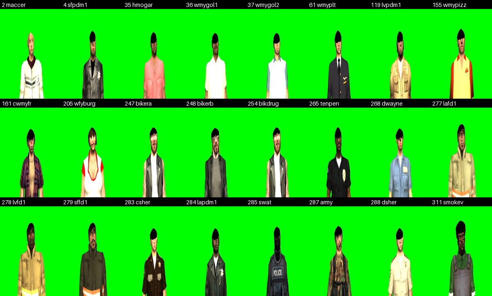
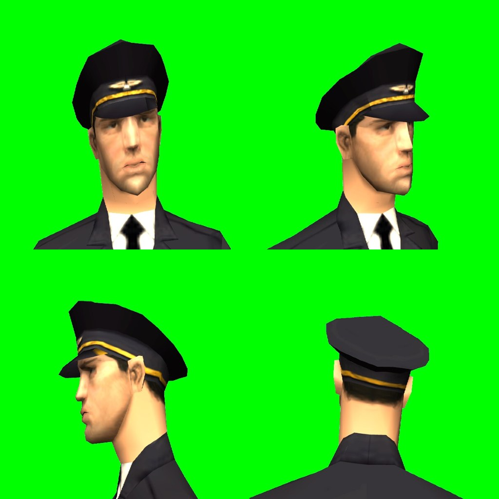
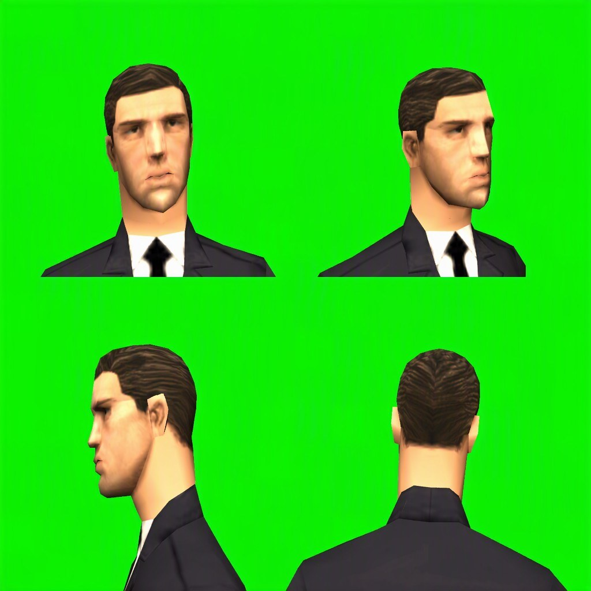
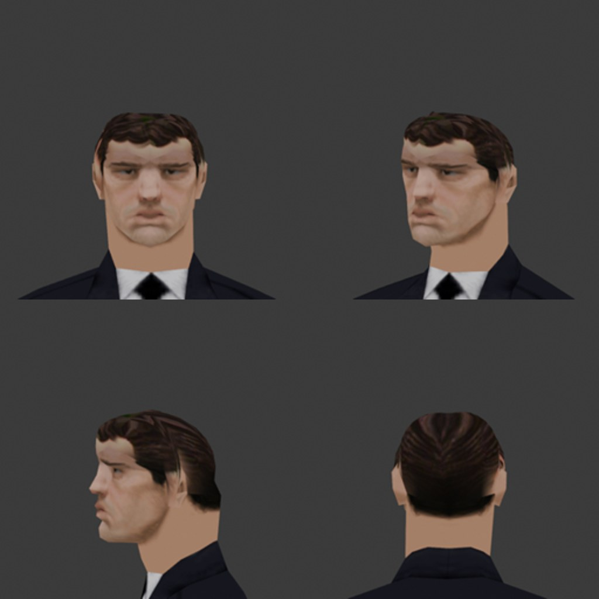

# Add a hatless twin for a skin with built-in headgear

Some GTA:SA skins carry their hat, cap or helmet in the mesh (the sheriffs, the army and SWAT men, the
firefighters, the police caps, hard hats, the pizza and burger uniforms, the bikers, ...). A worn hat sits on the
head bone, so the built-in one pokes through it. The fix (#75) is a copy of the skin with that headgear cut
away, which each client shows in place of the real skin while a hat is worn: the server and the database never
see the twin.

## Pieces

- `tools/extract_ped_models.py`: `HEADGEAR` lists the skins. For each it pulls `<name>.dff` from `gta3.img`,
  runs Blender headless with DragonFF (`tools/blender/cut_headgear.py`) and writes
  `resources/[scavengesurvive]/models/files/<name>_nohat.dff`, `models/peds.lua` (base skin -> twin) and
  `models/meta.xml` (both manifests). The twin shares the base skin's TXD, so nothing else is extracted.
- `models/client/main.lua`: loads every twin with `engineRequestModel("ped", base)` on the client, so the ids
  differ per client like the object ids, and exports `hatlessSkin(base)`.
- `items/client/attach.lua`: when a player's hat slot fills, the client calls `setElementModel` on that player
  with the twin; when it empties, with the real skin again. Client-side `setElementModel` is never synced.
  `swapped[player]` keeps the real skin, and every per-skin row (`skins.lua`) is looked up by it. A server-side
  skin change (duty, clothes) arrives through `onClientElementModelChange`, which drops the swap and re-applies
  it for the new skin; the pack reloading or stopping re-applies through `sampModelsChanged`.

## Adding a skin

1. Confirm the clipping in the studio: `rcon.ps1 studio 
 face`, set the skin and wear a hat
   (`lua setElementData(p, "items.hat", "HelmArmy")`), screenshot.
2. Add the skin to `HEADGEAR` in `tools/extract_ped_models.py`: `(dff name, texture name, "auto", 0.045)`. The
   texture name is what `engineGetModelTextureNames(skin)` returns on a client (`rcon.ps1 clua`). `"auto"`
   cuts the faces above the Head bone whose 8x8 texture block reaches further from the head axis than a bare
   skull (0.135 m) or higher than one (0.21 m); `cut_headgear.py` prints the blocks it chose. When that takes too
   much or too little, list the blocks by hand as `"col,row;col,row"` (row 0 at the top of the texture; dump the
   atlas with `engineGetModelTextures` + `dxGetTexturePixels` to see it), or `"*"` for every block when a cap
   shares its blocks with the hair (then everything above the floor goes, which a worn hat covers). The last
   number is how far above the Head bone the cut starts; the bone sits at the chin.
3. `python -m tools.extract_ped_models <skin>` (needs the GTA:SA install from the registry or `--gta`, and
   Blender with the DragonFF add-on, found under Program Files or given with `--blender`). Commit the DFF,
   `peds.lua` and `meta.xml`.
4. `rcon.ps1 rr models`, then `rr items`, and screenshot the skin with a hat on and off. Bare, the twin shows the
   hole GTA leaves under the headgear; that is expected, since it is only ever shown under a hat.

## Bare heads (remodelled skulls)

A twin cut by `cut_headgear.py` is hat-only: GTA models no skull under a hat, so bare it shows a flat fill or a
hole. `tools/blender/remodel_head.py` builds a bare head instead: it deletes the headgear by height, texel darkness
or texture block (`HEADS` holds the rule per skin, set by eye), welds the cut rim and raises a skull over it, a
thin band that continues the face skin and rings of hair textured from the darkest patch of the ped's own atlas,
all weighted to the Head bone. Run it in Blender (`blender --python tools/blender/remodel_head.py -- <ped dir>
<out dir> [skin ...]`, the ped dir holding `<name>.dff` and `<name>.txd` from `gta3.img`) and judge the result in
the viewport and the studio (force the twin bare with `clua 
 setElementModel(localPlayer,
exports.models:hatlessSkin(<skin>))`). All 22 headgear skins have a remodelled bare head: police and sheriffs (4, 119, 284, 283, 288), military and SWAT
(287, 285), firefighters (277-279), services and civilian (61, 35, 155, 205, 161, 36, 37, 2, 311), and bikers
(247, 248, 254). Most of those domes still read as a dark helmet rather than hair (#75). Tenpenny (265, bald) and
dwayne (268, a blond ponytail) wear no headgear and have no twin (#87).

Two facts cost a long detour: a DFF stores one UV per vertex, so a hairline vertex needs a skin copy and a hair
copy; and the exporter is fine with new vertices, so when a head looks stretched in the game compare the dome's
size with the face, not the file.

## Reference images (#89)

GTA models no skull under a hat, so the bare head has to be invented. `tools/hatless_refs.py` makes a reference for
each headgear skin:

1. `python -m tools.hatless_refs shoot` takes four studio shots of every original skin through `rcon.ps1`: front,
   three-quarter, side and back, at head height. It needs the dev server up, the player logged in and no other
   session using the studio. Allow about 5 minutes for all 22.
2. `POLLINATIONS_KEY=sk_... python -m tools.hatless_refs edit [skin ...]` pastes each skin's four views into one 2x2
   grid (`docs/images/hatless-refs/<skin>-studio.jpg`). It sends the grid to Pollinations `gpt-image-2` with the
   skin's row of `HATLESS`: who it is, the headgear, and the hair to show. The result is `<skin>.jpg`. One call per
   skin keeps the hair consistent across the four views; skins that already have a result are skipped. Each call
   costs about 0.031 Pollen, and the key must be allowed to use `gpt-image-2` on enter.pollinations.ai/keys.

| studio | generated |
| :---: | :---: |
|  |  |

All 22 skins have a reference. Pollinations made 2, 4, 35, 36, 37 and 61 until the free balance ran out. Gemini in
the browser made the other 16: upload the `-studio.jpg` grid to a new chat, give it the `prompt(skin)` text and
download the full-size image. It returns 2048x2048, so resize it to 1024. On SWAT 285 the prompt keeps the
balaclava. Codex CLI's built-in image tool is hidden on a ChatGPT Free plan. The free Hugging Face Spaces (FLUX.1
Kontext, Qwen-Image-Edit) share one anonymous ZeroGPU quota, which runs out after about three images.

`blender -b --python tools/blender/render_head.py -- <out prefix> <dff> <txd> [txd ...]` renders a head from the same
four sides, flat-lit and without the game. Use it to compare an original skin, its twin and the reference while
remodelling.

## Rebuilding a head from its reference (#89)

`tools/hatless_rebuild.py` replaces a twin's bare head with one built from its reference image. The studio camera is
known (`tools/hatless_proj.py`), and so is each skin's Head bone matrix in the studio
(`tools/data/hatless_calib.json`, taken with `calibrate`). So every point of the head maps to the reference pixel
that shows it:

| reference | rebuilt (Blender) |
| :---: | :---: |
|  |  |

1. Add the skin to `PLANES`, the cut plane in Head bone metres: `front` at the brow, `back` under the hat's rim. Read
   both off a side shot with height lines drawn on it; the bone sits at the jaw on these skins, the brow near 0.1.
   `blocks` lists atlas cells (col, row) of headgear that escapes the automatic rule, such as a visor.
2. `python -m tools.hatless_rebuild prep <skin>` registers the images: the mesh against the studio silhouette (the
   idle pose shifts the head a few pixels), and the reference against the studio grid below the brow. The image
   model re-frames each view, by up to about 50 px and 5%. It also measures the studio's lighting factor, so the
   hair texture is not lit twice. The results go to `tools/data/hatless_prep.json`.
3. `python -m tools.hatless_rebuild build <skin>` runs `tools/blender/rebuild_head.py`:
   - It cuts above the plane and deletes the hat's own atlas blocks: blocks used above the plane and nowhere on the
     kept face, neck or body, plus the ones `port_hats.py` and `HEADGEAR` list.
   - It carves a skull out of the reference's silhouettes in the four views.
   - It bakes a 256x256 hair texture from the reference.
   - It writes `<name>_nohat.dff` and `<name>_nohat.txd`. That TXD holds only the hair; `models` imports it into the
     base skin's shared dictionary, and `peds.lua` lists it.
4. Restart `models` and look at the twin bare in the studio. `tools/blender/render_head.py` shows it without the
   game.

Rebuilt so far: 2, 35, 36, 37 and 61. The other 17 keep their domes until they get a plane.

## Hat items from the cut (#77)

The faces the remodel deletes are the skin's own hat, so `tools/port_hats.py` turns the distinct ones into items.
One row per headgear: uname, display name, skin, ped DFF name, loot tables with weights and the atlas `blocks`.
Each hat gets a port model id from 20001 up. `python -m tools.extract_ped_models --hats` pulls each skin's DFF and
TXD out of `gta3.img` and runs `remodel_head.py --only hats --blocks c,r;c,r` headless. The HEADS rule of that
skin decides what is hat. The exporter copies those faces into the Head bone's frame and writes
`files/<ped>_hat.dff`, then `hats.lua` (the skin's TXD through `txdModel`, the beanie's collision through `col`)
and `meta.xml`.

GTA models a skull patch under each hat, textured with a smear of the face, and the cut carries it along. The
`blocks` column drops it: it lists the (column, row) cells of an 8x8 grid over the skin's texture, row 0 at the
top, and only faces whose UV centre falls in those cells are kept. Read the cells off a sheet of the textures with
the grid drawn. Ped meshes are wound every which way, and MTA culls a worn object on the opposite side from a
free-standing one. So the exporter recalculates normals and writes every face twice with reversed winding, a
double-sided shell, which is solid worn and alone. Then run `python -m tools.convert items loot` for the item types
(generic, size 1, `roty` 270 so the X-up mesh stands on the ground) and the loot rows. Apply the seed and restart
`models`, `data` and `items`. `items/shared/logic/apparel.lua` lists the unames in `CUT_HATS`, worn on SA-MP bone 2.
Per-skin fit lives in `CUT_HAT_FIT`, borrowed along the `skins.lua` chain: skin 283 is the zero row, skin 93 is
scale 1.1 at zero offset. Add a `CUT_HAT_FIT` row for a skin that needs one, not an `OVERRIDES` row. Judge each
hat from six angles, worn and alone, and from the side camera (`studio 
 270 1.4 0.75 0.65`), not the face
preset, which looks up at the brim and makes the hat seem pitched back.

A block can be hat only above a height (`above={(c, r): metres}` in the row) when it shares the atlas with the hair
under it, as the bucket hat's crown top does. To check a block choice, colour the unfiltered cut by block in Blender
(one material per block, four views): the skull patch sits well inside the crown's radius, the shell on it.

Left out on purpose: headgear a SA-MP object already covers (police caps, SWAT and army helmets, the pizza cap, the
beanie) and cuts that are mostly hair (dwayne's mullet, bikerb's bandana).

## Caveats

- Never restart `models` while a client is still downloading (docs/runbooks/start-stop-restart.md).
- A twin cut with `"auto"` can take some hair with it: harmless under a hat, but check the brow line and the
  ears, which a small hat (beanie, cap) does not cover.
- Skins whose headgear is the whole head (the chicken suit 167) cannot be fixed this way; leave them out.
